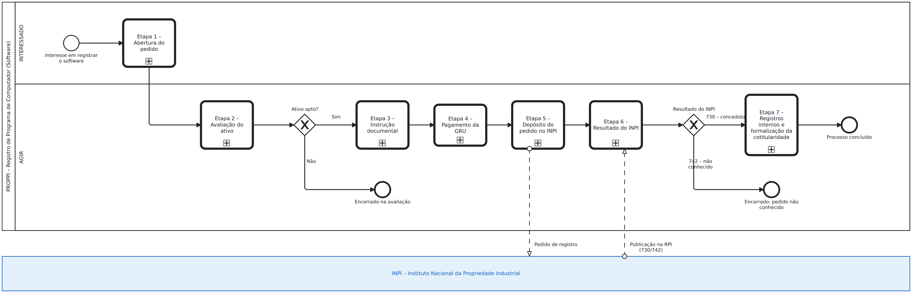

# Registro de Programa de Computador (Software) – AGIR/UFF

Modelagem **AS-IS** (estado atual) do registro de software conduzido pela AGIR junto ao INPI, do interesse inicial até os registros internos e o encerramento. Não há TO-BE nem propostas de melhoria.

- **Base:** recorte do modelo "PROPPI – Registro de Patentes, Marcas, Desenhos Industriais e Programas de Computador" (v08), complementado com as atividades da AGIR, do interessado e do INPI.
- **Fontes:** normas oficiais do INPI e entrevista com o solicitante (25–26/11/2026).

**Legenda:**
- sem cor = atividade do modelo original;
- 🟩 verde = atividade nova, confirmada;
- pool azul = INPI (participante externo em destaque).

## Documentos

- [Relatório AS-IS](docs/relatorio-asis.md): o que foi preservado, as atividades novas, as lacunas resolvidas, as justificativas e as fontes do INPI.
- [Macroprocesso](docs/macroprocesso-registro-software.md): arquitetura de processos, mapa das etapas, SIPOC por etapa e matriz RACI.

## Macroprocesso

[`macro/00-macro.bpmn`](macro/00-macro.bpmn): cada etapa é uma *call activity* que chama o diagrama da etapa.



## Etapas

| # | Etapa | Diagrama |
|---|---|---|
| 1 | Abertura do pedido | [01-abertura.bpmn](etapas/01-abertura.bpmn) · [imagem](etapas/01-abertura.png) |
| 2 | Avaliação do ativo | [02-avaliacao.bpmn](etapas/02-avaliacao.bpmn) · [imagem](etapas/02-avaliacao.png) |
| 3 | Instrução documental | [03-instrucao.bpmn](etapas/03-instrucao.bpmn) · [imagem](etapas/03-instrucao.png) |
| 4 | Pagamento da GRU | [04-pagamento.bpmn](etapas/04-pagamento.bpmn) · [imagem](etapas/04-pagamento.png) · [drill-down do pagamento](etapas/04-pagamento-a_pagamento.png) |
| 5 | Depósito do pedido no INPI | [05-deposito.bpmn](etapas/05-deposito.bpmn) · [imagem](etapas/05-deposito.png) |
| 6 | Resultado do INPI (730 / 742) | [06-resultado.bpmn](etapas/06-resultado.bpmn) · [imagem](etapas/06-resultado.png) |
| 7 | Registros internos e formalização da cotitularidade | [07-registros.bpmn](etapas/07-registros.bpmn) · [imagem](etapas/07-registros.png) |

## AS-IS completo

[`as-is/registro-software-asis.bpmn`](as-is/registro-software-asis.bpmn) reúne o processo inteiro num único diagrama: raias INTERESSADO, AGIR e Outras unidades da UFF, com o INPI e os Cotitulares externos como participantes externos. [Ver imagem](as-is/registro-software-asis.png). O diagrama é largo, então convém abrir o `.bpmn` num editor BPMN.

## Fontes e regeneração

- `fontes/registro-software-asis.json` é a **fonte única** do processo.
- `scripts/gerar_etapas.py` deriva dela as etapas e o macro (`fontes/etapas/`).
- `scripts/gerar_doc.py` gera o documento do macroprocesso.
- `scripts/gerar_tudo.js` roda tudo em sequência (é o que `npm run registro-software` chama).

Para regerar tudo, rode na raiz do repositório:

```bash
npm run registro-software
```
