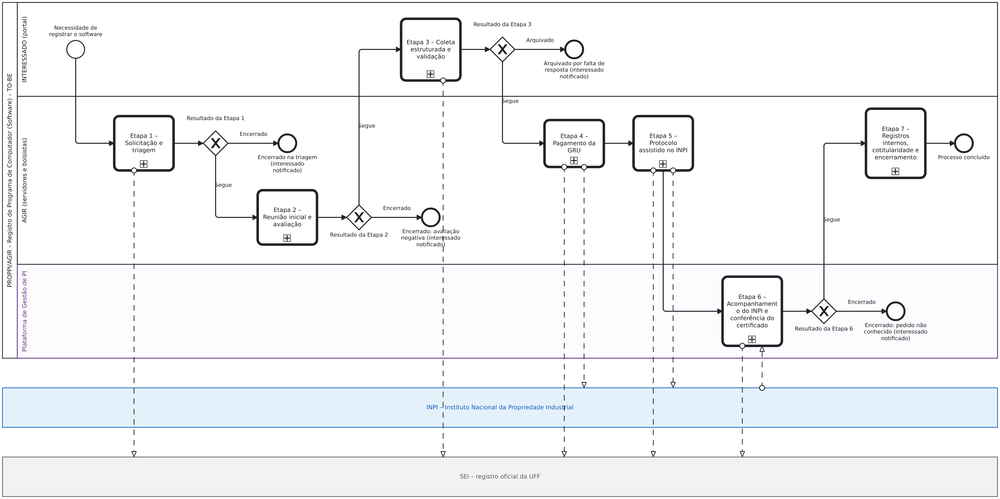

# TO-BE – Registro de Programa de Computador (Software) – AGIR/UFF

Estado **futuro** do processo, redesenhado para resolver os sete gargalos levantados com o dono e os sponsors do processo, usando investimento em tecnologia (Novo PAC). O SEI continua sendo o registro oficial e a equipe não aumenta.

**Legenda:**
- 🟩 verde = atividade nova ou alterada em relação ao [AS-IS](../);
- sem cor = mantida igual;
- raia **AGIR (servidores e bolsistas)**: o papel de cada tarefa está no documento;
- raia lilás = **Plataforma de Gestão de PI** (atividades automáticas);
- eventos com envelope = notificações automáticas;
- pool azul = INPI; pool cinza = SEI.

**Foco:** o diagrama detalha as melhorias prioritárias (atendimento e agenda, coleta e validação de dados, acompanhamento do INPI). O pagamento e a conferência do certificado aparecem simplificados, e a Etapa 7 reaproveita o AS-IS. Os detalhes estão no documento (seção "Escopo do diagrama").

**Documento completo:** [to-be-registro-software.md](docs/to-be-registro-software.md). Ele traz:
- gargalos × melhorias;
- sistemas e viabilidade;
- automação × atividades humanas;
- exceções;
- aderência às restrições;
- comparativo com o AS-IS;
- KPIs;
- requisitos da plataforma.

## Macroprocesso

[`macro/00-macro.bpmn`](macro/00-macro.bpmn): cada etapa é uma *call activity*, e os gateways mostram onde o processo pode terminar.

## Etapas

| # | Etapa TO-BE | Corresponde no AS-IS a | Diagrama |
|---|---|---|---|
| 1 | Solicitação e triagem | Abertura do pedido | [bpmn](etapas/01-solicitacao-triagem.bpmn) · [imagem](etapas/01-solicitacao-triagem.png) |
| 2 | Reunião inicial e avaliação | Avaliação do ativo | [bpmn](etapas/02-reuniao-avaliacao.bpmn) · [imagem](etapas/02-reuniao-avaliacao.png) |
| 3 | Coleta estruturada e validação | Instrução documental | [bpmn](etapas/03-coleta-validacao.bpmn) · [imagem](etapas/03-coleta-validacao.png) |
| 4 | Pagamento da GRU (simplificada) | Pagamento da GRU | [bpmn](etapas/04-pagamento.bpmn) · [imagem](etapas/04-pagamento.png) |
| 5 | Protocolo assistido no INPI | Depósito do pedido no INPI | [bpmn](etapas/05-protocolo.bpmn) · [imagem](etapas/05-protocolo.png) |
| 6 | Acompanhamento do INPI e conferência do certificado | Resultado do INPI | [bpmn](etapas/06-acompanhamento-certificado.bpmn) · [imagem](etapas/06-acompanhamento-certificado.png) |
| 7 | Registros internos, cotitularidade e encerramento | **Reaproveita o AS-IS**: call activity que chama a [Etapa 7 do AS-IS](../etapas/07-registros.bpmn) | [bpmn](etapas/07-registros-encerramento.bpmn) · [imagem](etapas/07-registros-encerramento.png) |

## TO-BE completo

[`registro-software-tobe.bpmn`](registro-software-tobe.bpmn) reúne o processo inteiro num único diagrama. [Ver imagem](registro-software-tobe.png). O diagrama é largo, então convém abrir o `.bpmn` num editor BPMN.

## Fontes

- `fontes/registro-software-tobe.json` é a **fonte única**: cada nó indica a sua etapa.
- `ferramentas/dividir_etapas.py` gera as etapas e o macro (`fontes/etapas/`).
- `scripts/gerar_doc.py` gera o documento.

Tudo é regerado com `npm run registro-software`, na raiz do repositório.
